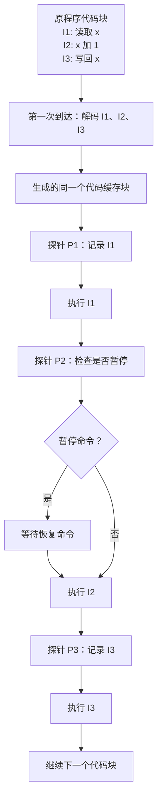
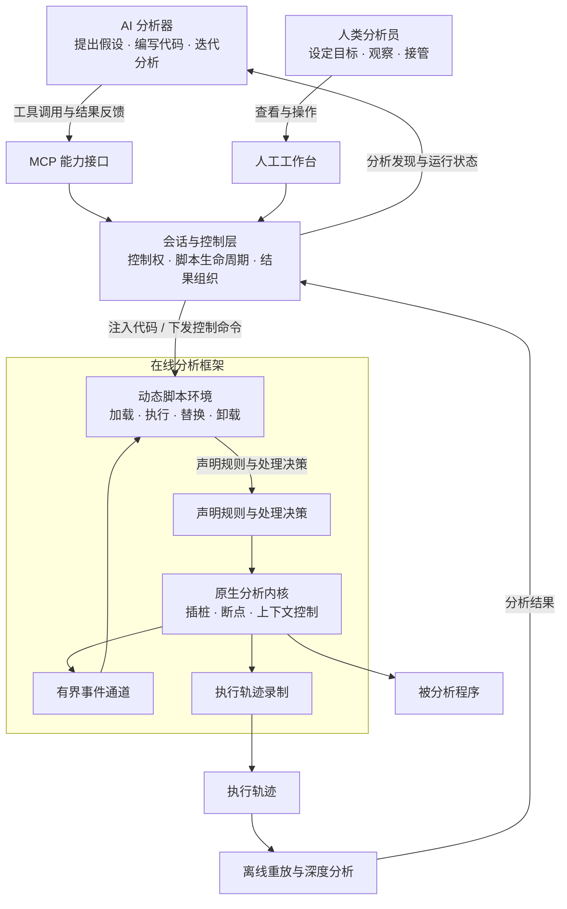
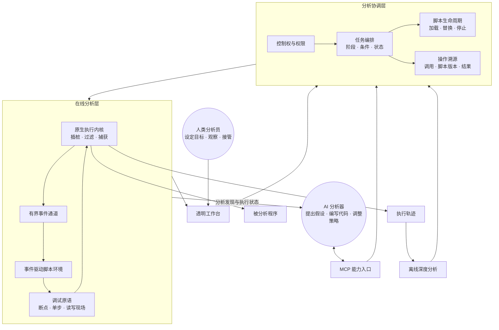
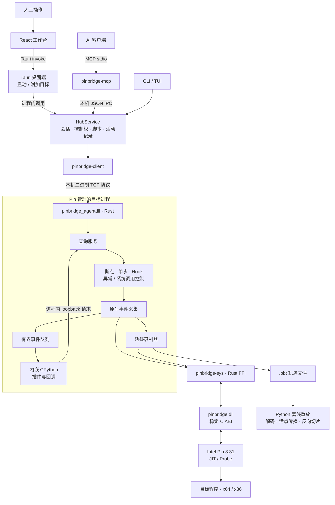
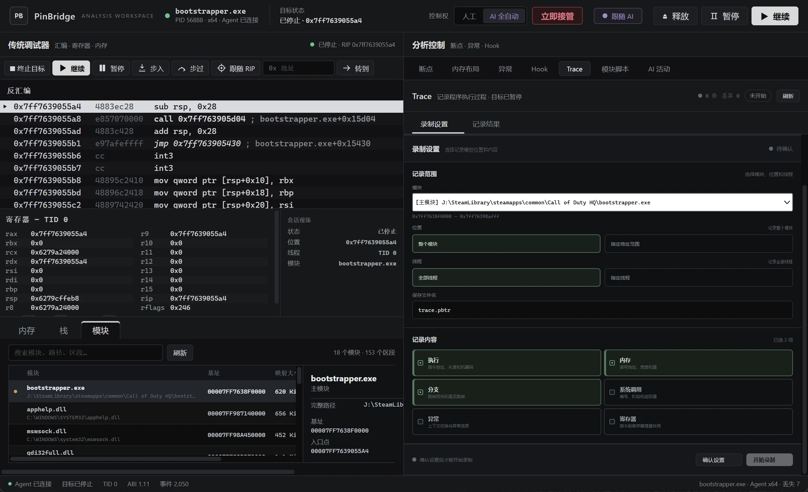
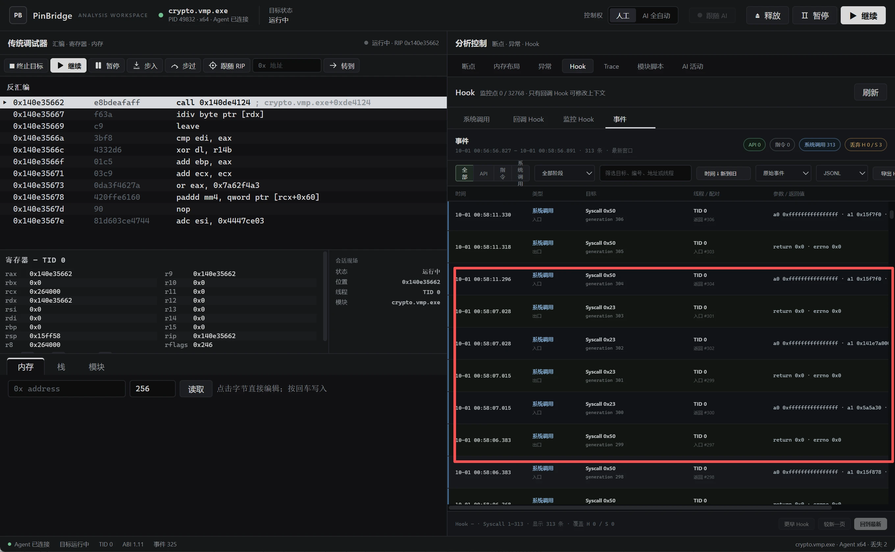

# [原创] AI 时代逆向分析：动态分析框架

- 来源：<https://bbs.kanxue.com/thread-293115.htm>（看雪安全社区 · AI 工具与工作流）
- 作者：BitWarden（uid 992284）
- 发布：2026-10-01 01:09（作者后有编辑）

---

## 前言

分享前阵子开发的 AI 动态分析工具。框架一直处于高强度实战项目对抗（VMP 等）之中，也在 KCTF 比赛中检验过工具强度，并且持续修改功能。感谢蓝队提供的样本。当前主要以 Windows 平台视角为主，重点是分享思路，具体姿势不关键。

（作者说明：文章为手写，除图片生成外无 AI 参与；项目开源，仓库见文末。**注：仓库链接已被作者编辑移除，页面中已无可用地址。**）

## 设计

### 需求

梳理这一年的困境与难点：

1. PC 侧三环（用户态）当前分析工具以 x64dbg 及各种基于 Windows 调试框架的调试器为主，需要处理环境检测，甚至需要进入内核对抗。
2. 主流工具（以 x64dbg 为例）开发时并非 AI 时代产物，大量代码设计是传统方式，如今多以插件形式支持 AI。在 AI 浪潮下传统方式已不是主导。
3. 基于 Windows 调试器框架对 VMP 的处理效率太低（常见的 trace、污点分析等），只能作为传统 debug 调试器使用，拿来做对抗效率低、影响产出。（Android 侧同样遇到 Linux 调试器环境检测问题。）
4. 基于内核层的反调试或异常接管，同样要挂在 Windows 调试框架下（Android 内核更不必谈），还受驱动签名、兼容性问题拖累。作者认为用内核调试器分析三环程序太重了：分析一个三环程序都要动用内核驱动甚至虚拟化层做"高打低"，那要分析虚拟化层本身怎么办？难道要在 ME 之类的微内核上做？

由这些反推即可得出需求定位。

### 技术选型

结论：基于 Windows 调试框架不适合作为基座。需要一种不依赖 Windows 异常机制、又不至于太重的框架（太重等于自己写虚拟机）。最终选择**插装（instrumentation）框架**作为基座，代表是 Pin 与 DynamoRIO（一个闭源、一个开源）。

### 插装介绍

插装即在运行代码时插入自己的逻辑。Pin 和 DynamoRIO 都自带 JIT：与传统的模拟执行不同，二者是基于二进制直接运行，而不是把指令翻译后在虚拟机里执行。传统模拟执行会遇到无法翻译的指令或对抗问题，例如切换到内核去的指令（在 Android 平台上尤其明显）。

插装框架会把目标程序代码加载到自己的缓存中运行，因此框架能知道在哪条指令处停下来，从而做到**指令级粒度**的控制。基于这个能力即可自建调试器。

**插装执行流程（原图为流程图，此处改为代码形式）：**



## AI 框架设计

传统调试器以人工为主，AI 时代以插件形式运行。LLM 处理静态二进制可以直接分析汇编，遇到对抗可用脚本做静态分析。但动态分析存在以下问题：

1. **驱动姿势问题**：人类断下后可以用肉眼查看软件内部上下文判断当前情况，AI 更倾向于**用代码来驱动**处理断下时的场景。
2. **主导权问题**：传统调试器 + MCP 的组合，主导权仍在人身上，不是"AI 主导、人辅助"。由此引出下面 3、4、5 的问题。
3. **权限问题**：AI 具体调用 MCP 做了什么，没有直观展示，需要靠日志、debug，或借用 Hermes 自带的 MCP / tools（函数调用抽象出的接口层）。
4. **上下文问题**：长上下文中，AI 想较灵活地分析框架，一般只能调用自由度较低的接口（MCP 或其他产品的 tools）再配合静态代码分析。AI 调用接口的顺序是什么？调完 MCP 后跑了哪个分析脚本？结果是什么？还得依赖其他手段记录和溯源。
5. **自由度问题**：函数调用接口在二进制分析上不是好选择——它只能控制已有函数接口的输入与输出。
6. **时效性与复杂场景**：例如脱壳要先处理真实 OEP，再根据 OEP 情况 Dump，这是一套"组合拳"，不是几个 MCP 加静态脚本能处理的；要硬做就得付出更大代价、更多 token、来回返工。

## 框架架构

据此设计一套**以 AI 为主、人类为辅**的分析平台：以代码驱动，通过 MCP 接口把代码动态注入框架中执行。

- 架构上，人与 AI 是**平级**的，而不再是一个插件或外挂脚本。
- 理想状态下人只是**观察员**，观察 AI / agent 在干什么。
- 理想状态下动静配合做到**完全无人值守**分析，人只在外部观察。

### 总体架构（原图为架构图，此处改为代码形式）



### 理想状态下的运行时角色（原图为架构图，此处改为代码形式）



### 代码框架与组件（原图为架构图，此处改为代码形式）



利用插装能力封装了**四种介入时机**：

1. 断点时机
2. Windows 异常时机
3. 系统调用 Hook 时机
4. 指令集模板匹配 Hook 时机

工具提供庞大的 trace 功能，既支持手工 trace，也支持 AI 代码驱动 trace。对 AI 而言这些时机分类可能冗余，但方便人工查看，所以分了多种情况。



## 实现

- 内部解释器没有像 Frida 那样用 JS 解释器，而是用 **Python** 解释器。
- 整个项目主要用 **Rust** 构建；Pin 本身是 C++ 写的，因此用 C 写了一层兼容层。

### trace 压缩

无论在 x64dbg 还是 Frida 下，VMP 对抗环境 trace 出来的文件都非常巨大，因此做了几种 trace 压缩算法与策略：

**1. 录制线程判断是否延续当前重复段**

```rust
let expected = previous
    .sequence
    .saturating_add(pending_repeats)
    .saturating_add(1);
if expected == event.sequence && same_payload(&previous, &event) {
    pending = Some(previous);
    pending_repeats = pending_repeats.saturating_add(1);
}
```

`same_payload` 比较事件类型、线程、地址和 arg0 至 arg7，**不比较序号**；只有序号连续且内容完全相同才会合并。

**2. 处理重复指令**

```rust
if repeat_count > 0 {
    let repeat = Event {
        sequence: event.sequence.saturating_add(repeat_count),
        kind: EVENT_REPEAT,
        thread_id: event.thread_id,
        address: event.address,
        arg0: repeat_count,
        arg1: event.kind as u64,
        ..Event::EMPTY
    };
    write_record(scratch, &repeat);
    writer.write_all(scratch)?;
}
```

**3. 寄存器重复处理**：寄存器没有变化就不需要记录。

### Windows 调试标志位处理

插装框架并非 100% 全覆盖。在 VMP 对抗中发现一个问题：

- 目标程序设置 TF（Trap Flag）后，处理器会在下一条指令执行后产生单步异常；在 VMP 等保护场景中，这个异常可能是程序**主动设计的陷阱**。
- 插装的 JIT 生成的是代码缓存中的指令。若让目标的 `POPF/POPFD/POPFQ` 直接设置**物理 TF**，单步异常可能发生在 Pin 的代码缓存地址，而不是预期的位置。
- 简单清除 TF 也不行，因为目标随后可能检查标志位，或依赖该异常进入自己的 VEH/SEH。

处理方式：在**应用指令边界**虚拟化目标设置的 TF。当 `POPF` 从栈中读到 TF=1 时，PinBridge 模拟其用户态标志位效果，更新应用上下文中的栈指针和下一条指令地址，同时避免把物理 TF 带进代码缓存：

```cpp
PIN_SetContextReg(context, REG_GFLAGS,
    EmulateUserPopFlags(current, incoming, width));
PIN_SetContextReg(context, REG_STACK_PTR, stack_pointer + width);
PIN_SetContextReg(context, REG_INST_PTR, next_ip);
AtomicStore(&state->pending, 1);
PIN_ExecuteAt(context);
```

## 功能演示

- HOOK 系统调用，分析 VMP 外壳行为，找到 Dump 时机：



- 标准的自解压 + 修改内存属性，绕过了系统调用：


利用这些信息即可完成外壳脱取。功能很多不逐一展示；整个 KCTF Windows 侧的分析全部用该工具完成。

## 总结

作者感慨第一次写博客写了又删、删了又写：想讲框架、代码实现等，但在 AI 时代又觉得没意义——把 Hermes 接上代码仓库扫一遍就都有了，所以只给仓库地址。博客只能讲讲对**当前工具与 AI 融合适配**问题的看法与解决思路。旧瓶装新酒已经装不下了，也是一次革命。欢迎评论区讨论想法，不做任何限制。
